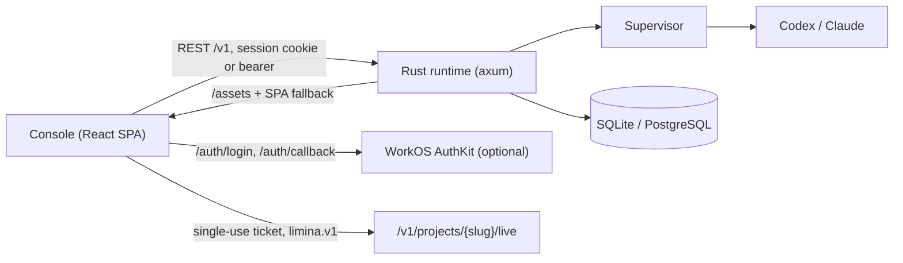

# Web console

The Limina console is the human side of a managed project: follow and steer the Codex or Claude
conversation, and read the project's knowledge vault. It is served by the runtime itself at
`http://127.0.0.1:7433` — there is no separate web server, backend-for-frontend, or identity
service to operate.

## What a user does there

| Surface | Purpose |
|---|---|
| **Projects** | Every project as a card, sorted so the ones that need you come first. |
| **Project switcher** | Vercel-style scope switcher at the top of the sidebar. Search and jump between projects while staying in the same section. |
| **Agent workspace** | The project landing surface: a dated mission assessment, pending decisions and the conversation with the agent. |
| **State** | Adjacent context for measurable targets, current objective, next step and success criteria. |
| **Results** | Adjacent previews and downloads of files deliberately published by the agent. |
| **Knowledge** | Search the whole project, browse paginated categories, read a complete note and follow H → E → F relationships. |
| **Settings** | Mission; engine, default model, reasoning mode and the project's own account; resources (variables and write-only secrets); sources; members. |

`⌘K` (or `Ctrl K`) searches pages, projects, and every knowledge note from anywhere.

### State and mission progress

The workspace keeps the project title readable, with a named route to the mission and success criteria.
Long objectives, next steps, blockers and outcomes show a short excerpt with **Read full…**;
the disclosure renders the complete Markdown and works with a keyboard. Operational status has
one home in the toolbar. Roles stay in membership settings.

**Mission progress → Add KPI** lets editors and owners define a name, success criterion, target,
unit and direction (at least / at most), plus an optional baseline. Record a current value with
an observation date and a supporting finding or completed experiment from the same project.
Measurement notes explain the evaluation conditions and remaining uncertainty. Viewers can read
the targets and evidence without editing them.

A missing measurement is **Not measured**, never zero. Each measured KPI shows whether its own
target is met. A baseline-to-target bar appears only when those values define meaningful progress;
it is not an overall mission completion score. Research and turn counts remain navigation or
activity information. Existing projects begin without KPIs; values are entered explicitly, not
extracted from prose or inferred from project status.

Definitions and measurements persist in the runtime database with version checks, idempotent
writes and audit events. A project can track up to 50 KPIs; State initially shows six with a
disclosure for the rest. Concurrent edits require reloading the latest version before saving.

| Endpoint / MCP tool | Access | Purpose |
|---|---|---|
| `GET /v1/projects/{slug}/metrics` / `limina_list_project_metrics` | viewers | Read definitions and latest measurements |
| `PUT /v1/projects/{slug}/metrics/{metric_id}` / `limina_set_project_metric` | editors | Replace a KPI using `metric` and `expected_version` (0 on creation) |

REST writes require `Idempotency-Key`. MCP accepts `idempotency_key`. A measured `current` needs
`evidence_id`; `direction` is `at_least` or `at_most`. Missing `current` is null. KPI updates emit
`project.metric.updated`, which refreshes the console.

### Conversation

The conversation opens with the latest dated, cumulative mission assessment: what evidence
supports, what was ruled out, what remains uncertain and any real decision. The agent authors it
through a structured checkpoint. A legacy checkpoint shows a labeled latest-outcome fallback.
Approvals record direction; they do not manufacture KPI observations or mark the mission complete.

State, Knowledge, Results and document tabs open beside the conversation, keeping its draft and
reading position. Historical note versions are read-only and dated. Files can be previewed and
downloaded without leaving the project. See the [workspace contract](agent-workspace.md) for limits,
HTTP/MCP access, the schema and official Opus 5.5 / GPT-6.1 Sol guidance.

**Explore the work and conversation history** reveals execution detail in pages of at most 50
items. Each turn has a divider showing its focus, duration, tokens and cost. Inside a turn:

- **Agent messages** render as Markdown. Artifact IDs such as `H002` become links with a preview on hover.
- **Tool activity** collapses consecutive commands, reads, edits, searches and subagent calls into
  one line ("3 commands, 1 edit"). Expand it to see each step, its state, exit code and duration.
  Tool output, reasoning and diffs are never shown.
- **Knowledge writes** appear as chips ("Proposed H003 · …") that open the note.
- **Checkpoints** summarize what the turn decided, the next step, and the blocker if any.

Your messages carry receipts. **Delivered live** means the running turn received the message.
**Queued for next turn** means it is stored durably and read when the next turn starts.
**Incorporated** means Limina acknowledged it at a checkpoint. When Limina is blocked on you, the
composer switches to **Answer** and a banner shows the question. **Interrupt** stops the current
turn and pauses the project.

### Knowledge

Knowledge opens with search and categories, rather than an expanded graph. Results include the
entire project, including artifact IDs, titles and content. Each page contains up to 25 notes,
with explicit next/previous navigation, status filtering, result counts and filter reset. Query,
category, parent scope and cursor live in the URL. The command menu uses the same server search
and shows at most eight note matches before **Search all project knowledge**.

Rows show readable titles and a bounded excerpt with a **Read note** link. Parent links and
**Explore related evidence** let you follow H → E → F without loading every descendant.
`GET /v1/projects/{slug}/knowledge` and `limina_query_knowledge` share query, kind, status, tag,
parent and cursor filters. MCP can read a result by ID through `limina_get_knowledge`.

The note reader uses `GET /v1/projects/{slug}/knowledge/{artifact_id}/document`, which renders one
authorized note using the deterministic Markdown exporter. Reading a note does not require the
full vault snapshot. The complete export remains available for Obsidian and existing clients.
The console parses the requested note in the browser:

- status and parent evidence links accompany the complete readable note;
- `[[wikilinks]]` and artifact IDs open adjacent notes even when not downloaded yet;
- Markdown headings, tables and links are formatted for reading;
- the version selector reads 25 dated revisions at a time, with access to older pages;
- downloading a historical note preserves that revision's content; it never restores old state.

## Run it

```bash
docker compose up --build
```

Open <http://127.0.0.1:7433>. How you sign in depends on the runtime's configuration (see
[Sign-in](#sign-in)): directly on the localhost no-token default, with an access token, or with
your organization's account through WorkOS.

To start with a populated project, seed the scripted demo before `up`:

```bash
make ui-demo
docker compose up -d
```

The demo plays three scripted turns and stops at a decision it needs from you. The scripted engine
keeps no provider thread. When you answer, the configured real engine (Codex or Claude) takes
over from the knowledge base. The demo's history and numbers are illustrative, and its context says
so.

## Project model defaults

Choose **Default model** and **Reasoning mode** while creating a project. A draft's **Start**
action opens a kickoff review with the same controls. Owners can edit the saved defaults later
in **Settings → Engine**; changes apply to the next turn, including resumed provider sessions.
The engine itself is chosen before kickoff. Switching it clears the previous provider's defaults.

Both providers load their catalogs from the installed CLI on demand: Codex uses `model/list`;
Claude uses the `models` metadata from its Agent SDK initialize handshake, including resolved
model aliases and `supportedEffortLevels` for each model. There is no local model or effort
allowlist. Models without advertised effort levels offer only **Model default**. Custom IDs
remain available without guessed reasoning choices.

Discovery depends on the packaged provider CLI as well as the account. Keep the Docker provider
version pins current and rebuild the image when upgrading them: refreshing the selector cannot
upgrade an old CLI or the catalog it supports. The Codex pin is 0.163.0; the previous 0.144.4
returned only GPT-5.6 models for an account that exposes GPT-6 models on the updated CLI.
Claude is packaged through `claude-agent-sdk` 0.2.170, which bundles CLI 2.1.306; SDK 0.2.118
bundled CLI 2.1.209 and still advertised Opus 4.8, Sonnet 5 and Haiku 4.5. Check both providers
when updating a runtime image, including the returned model IDs and effort metadata.

The catalog refreshes whenever the controls open, every minute while visible, and through
**Refresh models**. Discovery failure is shown with a retry action; cached browser choices can
stay visible but are never replaced by an invented catalog. Within a project, discovery uses
that project's engine account and requires membership. Before project creation it uses the
runtime account. Connecting or disconnecting an account invalidates browser metadata.

**Runtime default** inherits the operator's `LIMINA_CODEX_MODEL` or `LIMINA_CLAUDE_MODEL`;
**Model default** leaves reasoning at the model's default. Existing projects inherit these
values until an owner saves an override. Discovery never sends a user prompt or starts a generation.

`POST /v1/projects` and owner-only `PATCH /v1/projects/{slug}` accept optional `model` and
`reasoning_effort` strings. On PATCH, absent/null keeps the current value, and an empty string
restores the default. Changing a model without supplying reasoning clears the old effort.
`GET /v1/runtime/engines/{engine}/models` returns fresh picker metadata to authenticated users.
Add `?project=<slug>` to use a project account; project membership is checked before discovery.
MCP project creation accepts the same optional defaults.

References: [Codex model discovery](https://learn.chatgpt.com/docs/app-server#models),
[Claude SDK server info](https://github.com/anthropics/claude-agent-sdk-python/blob/main/src/claude_agent_sdk/client.py).

## Engine accounts

Each project runs on an account, and each project keeps its own. Owners connect one in
*Settings → Engine*, or while creating the project:

- **Claude**: run `claude setup-token` on your own computer, sign in, and paste the long-lived
  token it prints. An API key works too. The token is encrypted with the runtime's secret key,
  never returned by the API, injected only into that project's Claude process (replacing any
  runtime-wide credential), and redacted from events.
- **Codex**: sign in with a ChatGPT device code. The sign-in lands in a Codex home that belongs to
  the project alone (`accounts/codex/<slug>` next to the workspaces), where Codex keeps it fresh.

New projects take you to the project sign-in when using your own account. After sign-in,
review the model and reasoning mode in the kickoff dialog before starting the first turn. Disconnecting removes the stored token or the project's sign-in.

Subscriptions are personal: connect your own account, and check your provider's terms for how it
may be used.

The console connects subscription accounts only inside a project. Operators can optionally set
runtime credentials outside the console for projects without their own account:

- **Codex**: `OPENAI_API_KEY` / `CODEX_ACCESS_TOKEN` in `.env`.
- **Claude**: `ANTHROPIC_API_KEY` in `.env`, then restart.

| Endpoint | Who | Purpose |
|---|---|---|
| `GET /v1/projects/{slug}/engine-accounts` | viewers | Which account each engine uses (label, method, who connected it) |
| `PUT …/engine-accounts/claude-code` | owners | Store a Claude token (`{"token": "…"}`) |
| `POST …/engine-accounts/codex/login` | owners | Start a device sign-in (`Idempotency-Key` required) |
| `GET`, `DELETE …/engine-accounts/codex/login/{login_id}` | owners | Poll or cancel the sign-in |
| `DELETE …/engine-accounts/{engine}` | owners | Disconnect |

## Sign-in

The console asks the runtime how to sign people in (`GET /auth/config`):

| Mode | When | What people see |
|---|---|---|
| `open` | Localhost default, no tokens configured | Signed in directly |
| `token` | `LIMINA_API_TOKEN` / `LIMINA_ADMIN_API_TOKEN` set | Paste a token (`make ui-open` opens the console signed in with the admin token from `.env`) |
| `workos` | `WORKOS_CLIENT_ID` set | Your organization's sign-in through WorkOS AuthKit |
| `oidc` | `LIMINA_OIDC_ISSUER` set | Paste an access token from your identity provider |

### WorkOS

With WorkOS, the runtime runs the server-side AuthKit flow itself:

1. `/auth/login` redirects to AuthKit's hosted sign-in with `state` and PKCE.
2. `/auth/callback` exchanges the code with the WorkOS API.
3. The session is stored in an encrypted (AES-GCM), HttpOnly, SameSite=Lax cookie.

The browser never holds a token. Each request verifies the WorkOS access token against the
client's JWKS with the User Management issuer pinned. An expired token is refreshed server-side and
the cookie is rotated. Writes made with the session cookie must come from the console's own origin.
Signing out ends both the Limina session and the WorkOS session.

In the [WorkOS dashboard](https://dashboard.workos.com):

1. Enable AuthKit and add the redirect URI `<public URL>/auth/callback`, for example
   `http://localhost:7433/auth/callback`.
2. Set the sign-out redirect to `<public URL>/signin?signed_out=1`.
3. Optionally create permissions, for example `limina:access` for who may sign in and
   `limina:admin` for runtime administrators, and assign them to roles.

Then set, in `.env` or the runtime environment:

| Variable | Purpose |
|---|---|
| `WORKOS_CLIENT_ID` | Client ID (`client_…`). Enables WorkOS sign-in. |
| `WORKOS_API_KEY` | Secret API key, used only by the runtime. |
| `WORKOS_COOKIE_PASSWORD` | At least 32 random characters that seal the session cookie (`openssl rand -base64 32`). |
| `LIMINA_PUBLIC_URL` | The URL people open, for example `https://limina.example.com`. It sets the redirect URI, the allowed origin for writes, and `Secure` cookies. Defaults to the request's own origin. |
| `WORKOS_REDIRECT_URI` | Optional explicit redirect URI; defaults to `<public URL>/auth/callback`. |
| `LIMINA_WORKOS_ORGANIZATION_ID` | Optional. Only members of this organization may sign in. |
| `LIMINA_WORKOS_REQUIRED_PERMISSION` | Optional permission every user needs, for example `limina:access`. |
| `LIMINA_WORKOS_ADMIN_PERMISSION` | Permission that makes a user a runtime administrator (default `limina:admin`): can set shared engine credentials; project access still requires membership. |
| `WORKOS_API_HOSTNAME` | Optional API host (default `api.workos.com`). |
| `LIMINA_WORKOS_ISSUER` | Optional comma-separated issuers, for custom authentication domains. |

People who sign in create projects as their owner and see the projects they are members of.
Owners share from *Settings → Members* using an email and a role. A verified user in the
organization gets access immediately; otherwise an invitation waits for their first verified sign-in.
Limina sends no email. Runtime administrators also need membership to see a project. Anonymous
access is never allowed in WorkOS mode, even with the localhost no-token default.

API and MCP clients can send a WorkOS access token as a bearer token. `LIMINA_API_TOKEN` and
`LIMINA_ADMIN_API_TOKEN` stay available as optional machine credentials for the CLI, MCP and CI.

## Connections

Add remote MCP servers in **Connections** using a name and a Streamable HTTP URL. Choose
**Sign in** to consent at the provider, **Token** or **Header** for write-only credentials, or
**No sign-in** for a public server. Sign-in uses the official Rust MCP SDK for protected-resource
and authorization-server discovery, dynamic registration, S256 PKCE, the resource parameter and
refresh. Providers without dynamic registration need the token/header alternative.

Then open **Settings → Connections** in a project and enable a connection you own. The next turn
can use its tools. Project members see the servers and their status, never credentials. Only the
connection's owner can enable or disable it; enabling also requires project ownership. If that
person loses project membership, their connection becomes inactive. Disconnecting removes it from
every project. An already-running turn keeps the configuration it started with.

Tokens, grants and pending sign-in state are encrypted with the runtime's secret key. A callback
requires its original browser cookie and is single-use, with a ten-minute expiry; pending flows
survive a restart. Refresh is serialized per connection within one runtime process. Run one
runtime process against a connection store; coordinating token rotation across replicas is not
supported yet.

Only HTTPS servers are accepted, with HTTP allowed for loopback development. Link-local and cloud
metadata addresses are refused, including DNS answers. Private HTTPS servers are supported.
Outbound requests have timeouts and response-size limits. Each server is trusted with whatever
data its tools receive; enable it only in projects where you want that access.

For operator recovery, the embedded CLI and static machine tokens remain trusted local operators.
Use `limina project share <slug> --email <email> --role OWNER` to grant access to an existing project after
switching to private project lists. This queues an invitation when no directory lookup is available.

## Develop it

```bash
make ui-dev      # runtime on :7433 with a scripted engine, no credentials needed
make web-dev     # Vite on :5173 with hot reload, proxying /v1 to :7433
make web-check   # typecheck, unit tests, production build
```

`limina dev` runs the real supervisor with a deterministic engine. It streams
commands, edits and messages, writes hypotheses, experiments and findings through the internal
capability API that Codex and Claude use, accepts live steering, can be interrupted, and asks
the human one decision. Project accounts work too: a pasted Claude token is stored as usual, and
the Codex sign-in shows a scripted code that confirms itself after a few seconds. Set
`LIMINA_DEV_SHARED_CREDENTIALS=0` to see the flow where every project must connect its own account.
Set `LIMINA_DEV_IMPORT=<project folder>` to also import a file-based Limina project (its `kb/`) as
a draft the first time, so a real project can be your development data. The import keeps artifact
IDs, statuses, dates and links, and nothing runs until you start the project. To import into any
database without the dev server, use `limina --database <url> project import <folder>`.
Open <http://127.0.0.1:5173/#token=dev-admin>.

## Architecture



- **One process.** The `limina serve` binary serves the built SPA from `LIMINA_WEB_DIR` (set in the image). An
  SPA fallback returns `index.html` for unknown non-API paths. Unknown `/v1` paths still return JSON
  404s.
- **Live updates.** The browser exchanges its session or bearer token for a 60-second, single-use ticket and
  opens the project WebSocket with it. The feed loads the newest page of events, pages backwards on
  demand (`?before=`, execution history has explicit pages), catches up after reconnects, and falls back to cursor polling. REST caches
  refresh from the event stream.
- **Transcript schema.** Provider events are normalized server-side
  (`crates/limina-engines/src/events.rs`). `kind` is one of message, tool, plan, status or
  knowledge. Each event also carries `text`, `tool`, `input`, `item_id`, `phase`, `state`,
  `exit_code`, `duration_ms` and `files`. Started and completed rows share an `item_id`. The
  structured checkpoint JSON and internal `limina _agent` command lines are never exposed.
- **Identity.** `GET /v1/me` identifies the caller; every project response carries the caller's
  `role`. Viewer, editor and owner capabilities come from the server and are never inferred in the
  browser.
- **Information hierarchy.** [design.md](../design.md) is the shared interface contract, linked
  from both agent instruction files. The project opens into Conversation; State, Knowledge and
  Results remain adjacent. Evidence uses focused reads instead of a full vault snapshot.

## Look and feel

The visual language is deliberately restrained:

- IBM Plex Sans for prose and IBM Plex Mono for chrome (navigation, buttons, labels, IDs, times);
- black and white surfaces with one gray secondary surface, and hairline structure;
- 4 px radius for contained surfaces, square writing inputs, no shadows;
- a yellow keyboard-focus ring, and color only when it carries meaning (state, attention, risk).

Interaction follows platform conventions:

- one primary action per view, progressive disclosure (sub-navigation appears inside its section);
- no layout shift while streaming, and scrolling that stays pinned to the newest activity only
  while you're at the bottom;
- full keyboard operation, reduced-motion support, and light and dark themes;
- a phone layout with a navigation drawer.

## Deliberately left out

The console keeps what a Limina user needs and leaves out, until there is a clear need:

- a cross-project attention desk and notification outbox (Slack/webhooks);
- a separate backend-for-frontend server: the runtime serves the console and its sign-in itself;
- a generated API client: the typed client in `web/src/lib/api.ts` is written by hand;
- per-run analytics pages. Run usage appears inline on each turn; outcome progress appears in
  State as evidence-backed KPIs.
